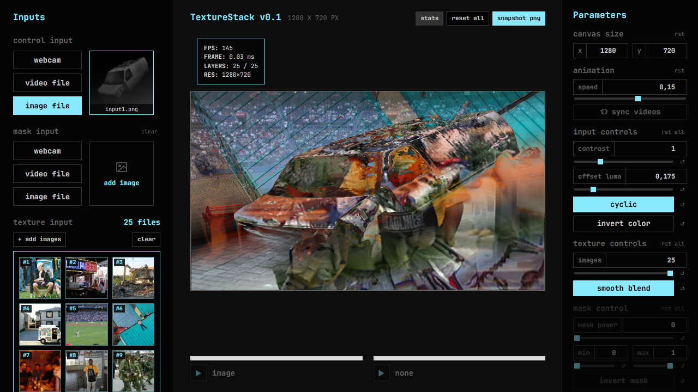
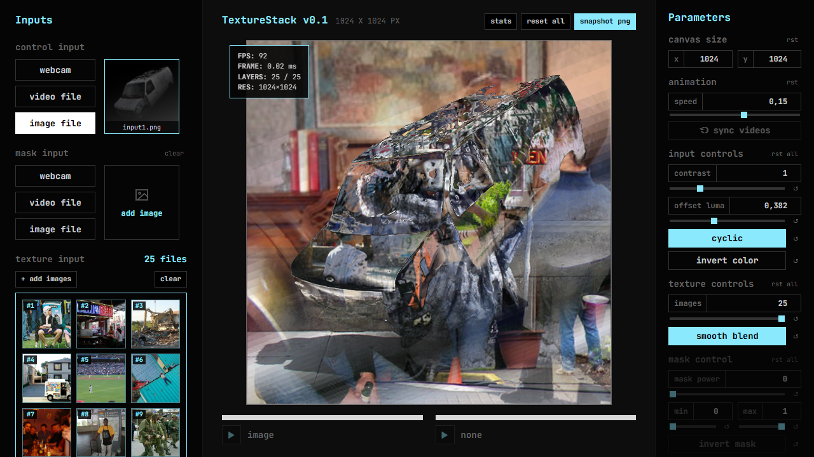
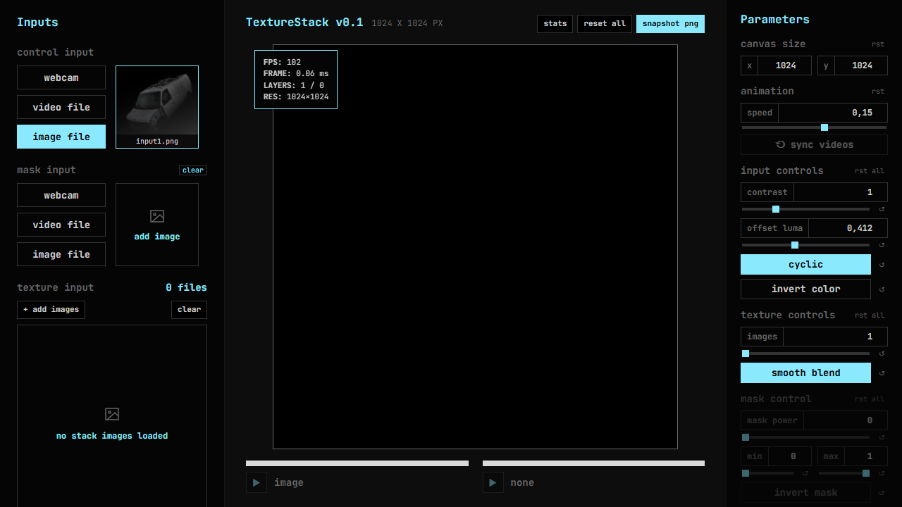
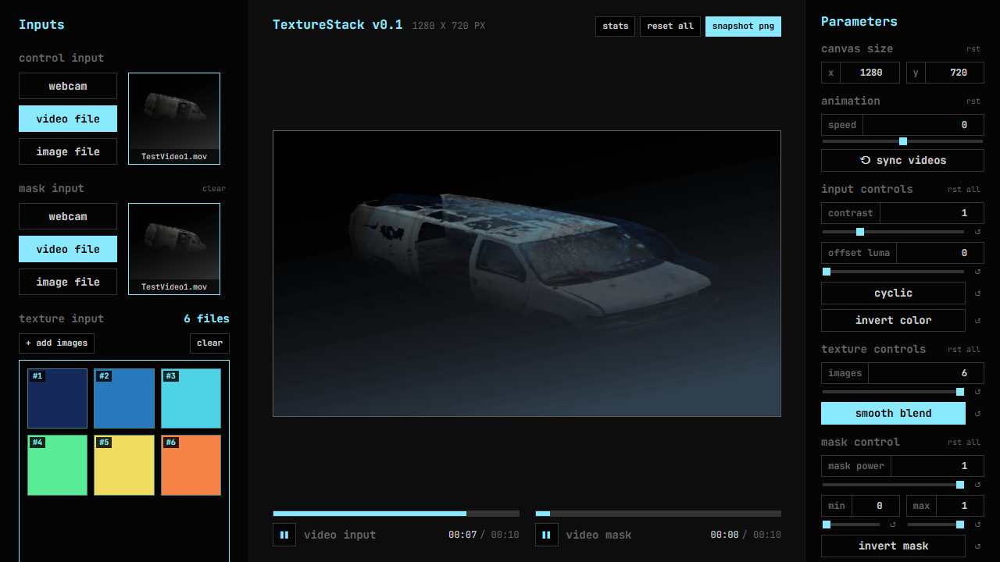
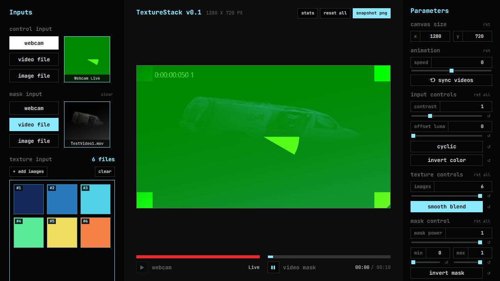

# Texture Stack v0.7 — Automated Test & Verification Report

Date: 2026-10-25 (updated after UX review round 1: D14 dual playback transports + D15 video sync)  
Spec Version: `Specification/texture-stack-spec-v0.7.md`

---

## 1. Automated Test Summary

All automated unit and end-to-end WebGL2 pixel tests passed with zero errors:

| Suite | Runner | Tests | Status | Duration |
|---|---|---|---|---|
| `tests/unit/shader-and-clock.test.ts` | Vitest (`v3.2.7`) | 8 passed | PASS | ~300 ms |
| `tests/e2e/texture-stack.spec.ts` | Playwright (`Desktop Chrome` WebGL2) | 6 passed (70+ assertions) | PASS | ~13.7 s |

### Verified Items (§8.2)

- **Shader pixel verification vs. plain-code CPU reference (§4)** (tolerance ±3 / 255):
  - **Stack selection:** Hard (`uSmoothBlend = 0`) and Smooth (`uSmoothBlend = 1`), Cyclic off (`uCyclic = 0`) and on (`uCyclic = 1`), seamless wrap from last layer (`n - 1`) to first layer (`0`) in cyclic smooth mode, `n = 1`, `n = 2`, `n = 32`, and `num images` lower than loaded (`5` of `32`).
  - **Control:** `contrast = 1` (unchanged), `contrast = 0` (flat mid-grey `0.5`), `contrast = 2.5` (boosted); `offset` with clamp (`cyclic = 0`) and wrap (`cyclic = 1`); BT.709 luminance weights (`0.2126`, `0.7152`, `0.0722`) verified with pure red, pure green, and pure blue control textures; `invert color` toggle.
  - **Mask:** White (`1.0`), black (`0.0`), and mid-grey (`0.5`) masks; `maskMin` / `maskMax` range remap including `maskMin > maskMax` (`0.8 > 0.2`); `invertMask`; `maskInfluence` at `0`, `0.5`, and `1`; mask luminance weights (`0.2126`, `0.7152`, `0.0722`) verified with pure R/G/B masks; verified that the original control image shown where mask is black (`m = 0`) has **no contrast and no offset** even when `contrast = 3.5` and `offset = 0.8`.
  - **Orientation & GL errors:** Verified across all 4 quadrants (`Top-Left`, `Top-Right`, `Bottom-Left`, `Bottom-Right`) and top/bottom split textures, with `gl.getError()` returning `[]` after every case.
  - **Transparency (D13):** Semi-transparent stack image (`alpha = 128`) flattened over black on load and output with opaque `alpha = 255`.
- **App & UI behavior:**
  - Control source switching between `video file` and `image file` without reloading the page (D1).
  - Stack add, remove, and reorder (`stack-move-down-0` / drag-reorder) updating GPU layer order immediately (D2).
  - 32 layers at `1280×720` (`TEXTURE_2D_ARRAY`, ~118 MB) allocated with zero GL errors (§5).
  - Mask controls disabled when no mask is loaded (`uMaskInfluence = 0`), automatically enabled with `maskInfluence = 1` on mask load, and disabled again on clear (D11).
  - Working resolution change (`1280×720` → `640×360` → `1024×1024`) resizing the output canvas and re-fitting stack layers (D4).
  - PNG snapshot (`captureSnapshotDataUrl()`) produces a valid PNG matching the working resolution with opaque `alpha = 255` (D7, D13).
  - Visible UI error toast (`[data-testid="error-toast"]`) when exceeding 32 images or loading unsupported files, and zero console errors on load (D9).
- **Offset animation with controlled clock (§3 & §8.2):**
  - `speed = 0` keeps `offset` frozen.
  - Positive speed (`0.2`) advances `offset` linearly (`start + speed × dt` wrapped to `0..1`) and moves the `offset luma` slider in the UI.
  - Negative speed (`-0.25`) runs backwards and wraps `0 → 1`.
  - Dragging the `offset luma` slider sets the current position and animation continues from there.
  - Hidden tab (`visibilitychange` / `setTabHiddenSimulated(true)`) pauses animation with zero jump on return.
  - Reset-to-default on `offset luma` resets both `offset` and `speed` to `0`.
  - With `cyclic` on, pixel output across the `0.999 → 0.001` wrap boundary has no jump.
- **Static HTTP serving (§8.2):**
  - Production `dist/` verified both at root (`/`) and mounted under a subfolder (`/subfolder/`) with zero missing files or console errors.
- **Dual playback transports per input media (D14, Figma "Progress Bar" frame):**
  - Control (left) and Mask (right) transports render independently.
  - Video source: enabled play/pause button, grey track + cyan progress fill, `MM:SS / MM:MM` time display, per-transport seeking via progress bar click.
  - Webcam source (verified with Chrome fake media device): red full track, `Live` label, no time display, disabled play button; switching control to webcam does not affect the mask video transport.
  - Image / none source: static light-grey track, no time display, disabled play button.
  - Pausing the mask video does not pause the control video.
- **Video sync & start-from-beginning (D15):**
  - A newly loaded video starts at `currentTime = 0`; loading a mask video does not reset the playing control video.
  - The `⟲ sync videos` button (in the Parameters column, `animation` group; disabled when no video is loaded) restarts all loaded videos from the beginning and resumes playback.
- **Input previews (U8):**
  - Webcam preview thumbnail is captured only after the first real frame arrives (`loadeddata`/`playing`), so the preview always shows live content on real hardware.
  - All source thumbnails (image / video / webcam / raw fixtures) are square **cover-cropped**: non-square media keeps its proportions and overflow is cropped (same rule as stack layers, D4). Verified with a 4:1 image with colored edge strips — edges are cropped out of the thumbnail, not squeezed in.

---

## 2. Performance Numbers (§8.2)

Measured in Desktop Chrome with WebGL2 at `1280×720` working resolution and 25 loaded dataset layers (`?demo=1`):

- **Average GPU render pass time (Stack pass → FX FBO pass → Canvas):** `0.03 – 0.30 ms / frame`
- **Observed frame rate in review build:** `93 – 166 fps` (well above the 30 fps target in §5)
- **32-layer allocation at `1280×720`:** Succeeded with `0` WebGL errors

---

## 3. Screenshots

### Demo Scene — 16:9 (`1280×720`) with Stats Overlay (`/?demo=1`)

### Demo Scene — 1:1 (`1024×1024`, Figma `Desktop - 1:1`)

### Empty Stack & Mask State (Figma `Empty sources`)

### Dual Playback Transports — Control video + Mask video (D14, Figma "Progress Bar")

### Playback Transports — Webcam "Live" + Mask video (D14)

---

## 4. Known Limitations & Not Verified (§8.4)

- **Physical webcam hardware stream:** The `webcam` transport and `getUserMedia` flow are verified end-to-end using Chrome's fake media device (`--use-fake-device-for-media-stream`); a physical camera was not tested in automation. The UI error toast path on permission denial is implemented and should be judged during review.
- **Sustained dual-video hardware decoding on battery/mid-range laptop GPU:** Single-tab Chrome WebGL2 rendering takes `< 0.3 ms/frame`, but real-world thermal/battery behavior with two simultaneous high-bitrate videos should be judged on your machine during review.
